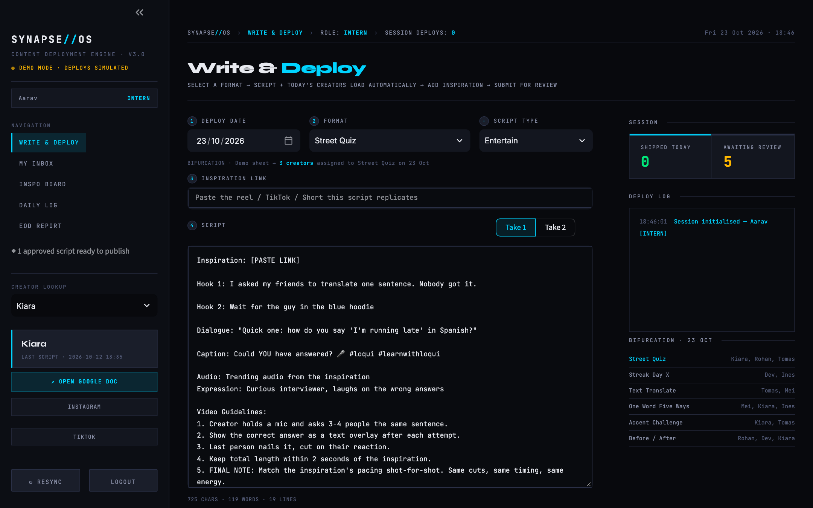
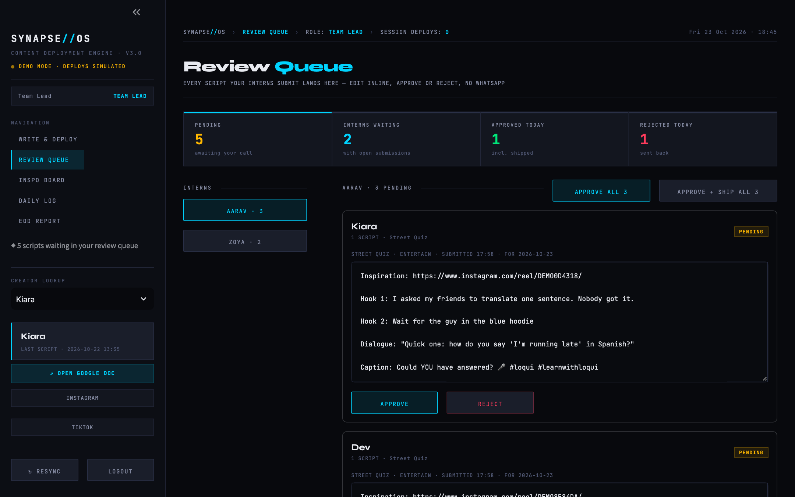
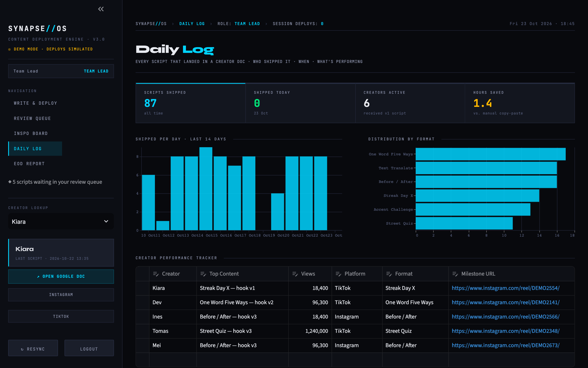
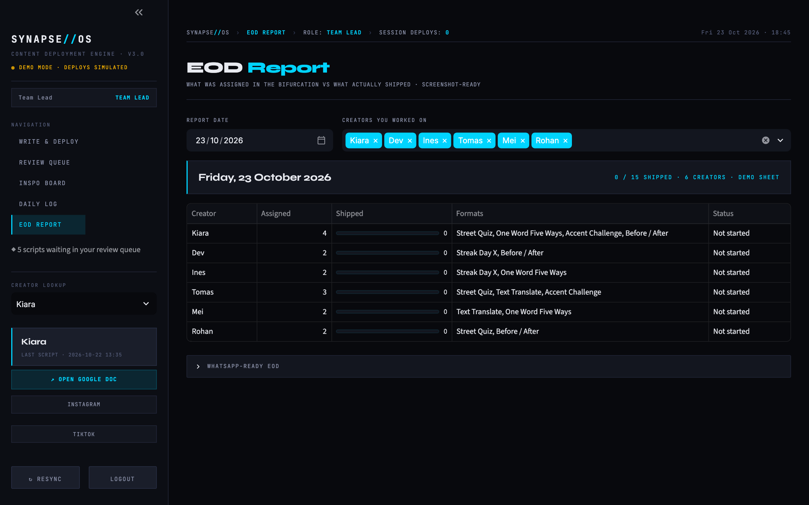
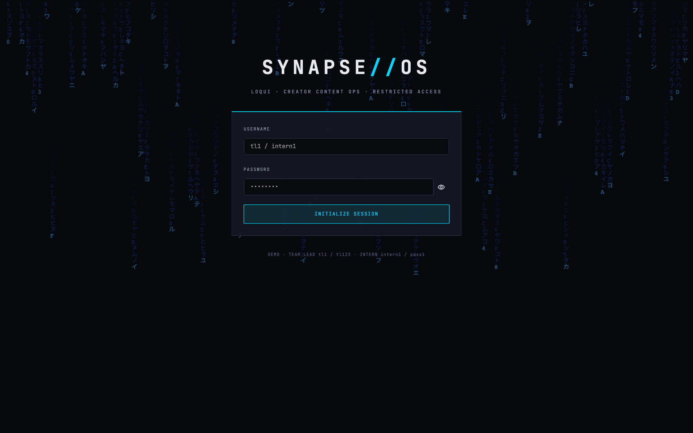

# SYNAPSE // OS

**A content deployment engine for UGC teams.** Interns write scripts from a shared format library, the Team Lead reviews everything in one queue, and approved scripts land at the top of each assigned creator's Google Doc in one click.

I built Synapse during my content and operations internship at **Airlearn**. I pitched it to the CGO, and it was approved for deployment.



> The data in this repo belongs to a fictional language-learning brand, "Loqui". All creators, scripts and links are made up for the demo.

---

## The problem

At Airlearn I was part of a content team that shipped **3,000+ scripts for 20+ UGC creators worldwide**, and those videos brought in **3M+ views**. The whole pipeline ran on Google Docs, Google Sheets and WhatsApp:

| The old way | What Synapse does instead |
|---|---|
| A daily "bifurcation" sheet assigns formats to creators, and interns cross-reference it by hand | Pick a format and today's assigned creators load automatically |
| Scripts are rewritten from scratch or copied out of old docs | A format library holds every proven script template, with multiple takes |
| The Team Lead approves hundreds of scripts a day in WhatsApp | One **Review Queue**: edit inline, then approve or reject one script, one creator, or everything |
| Every approved script is pasted by hand into each creator's Google Doc | **One-click deploy** writes a dated script to the top of every creator's Doc |
| Nobody can tell what shipped, when, or who shipped it | The **Daily Log** keeps an audit trail, charts, and hours saved |
| EOD reports are typed up by hand at the end of the day | The **EOD Report** shows assigned vs. shipped per creator, with a WhatsApp-ready summary |
| Inspiration reels sit in chats and bookmarks | The **Inspo Board** is one shared place for every reel worth replicating |

---

## Features

- **Two roles.** Interns write and submit. The Team Lead reviews, edits, approves and ships.
- **Format library.** Every content format (Street Quiz, Streak Day X, Before/After…) has full script templates. The inspiration link and brand hashtags are filled in automatically.
- **Bifurcation-aware.** The app reads the day's assignment sheet from Google Sheets and knows which creators get which format.
- **Batch deploy.** One click writes approved scripts into many creators' Google Docs at once, with a progress bar and an audit log.
- **Review Queue.** Grouped by intern, then by creator. Approve all, or **Approve + Ship** in a single action.
- **Daily Log and EOD Report.** Shipped-per-day charts, the format mix, a creator performance tracker, and a screenshot-ready end-of-day report.
- **DEMO and LIVE modes.** Without Google credentials everything runs on local demo data. With them, it writes to real Docs and Sheets.

## Screenshots

| Review Queue | Daily Log |
|---|---|
|  |  |
| **EOD Report** | **Login** |
|  |  |

## Tech stack

| Layer | Tools |
|---|---|
| App and UI | **Python**, **Streamlit**, custom CSS theme |
| Data | **pandas**, CSV data layer (`store.py`) |
| Integrations | **Google Docs API** and **Google Sheets API** through a service account (`google-api-python-client`) |
| Charts | Altair (via Streamlit) |

---

## Try it

Demo mode needs no Google account:

```bash
git clone https://github.com/adisharma200606-star/synapse-os.git
cd synapse-os
python3 -m venv .venv && source .venv/bin/activate
pip install -r requirements.txt
streamlit run app.py
```

Log in as **Team Lead** `tl1` / `tl123` or **Intern** `intern1` / `pass1`.

To connect real Google Docs and Sheets (LIVE mode), follow **[docs/SETUP.md](docs/SETUP.md)**.

## Project map

```
app.py              login, sidebar, routing
config.py           paths, config.json, date-tab resolver, bifurcation parser
google_api.py       every Google call (+ demo fallbacks)
store.py            CSV data layer + demo seed
deploy.py           batch deploy with progress + audit log
auth.py             users and roles
ui/                 one file per page
data/               creators, users, formats library, demo bifurcation, databases
seed_demo.py        Google setup checker + sheet seeder
reset_demo.py       fresh demo data
config.json         sheet ID, brand hashtags, org name
```

---

## About me

I'm **Adi Sharma**, a BBA (Decision Science) student at CHRIST University, Bengaluru. I work across growth, content operations and product, and I build tools like this when a workflow is broken.

[LinkedIn](https://linkedin.com/in/adi-sharma-6a492b272) · adisharma200606@gmail.com · [More projects](https://github.com/adisharma200606-star)
